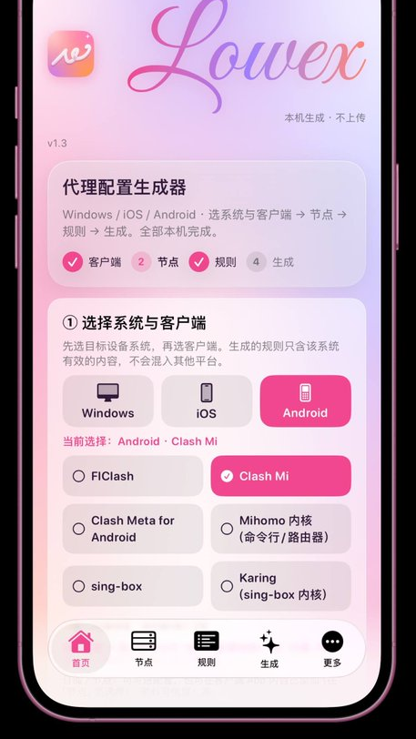
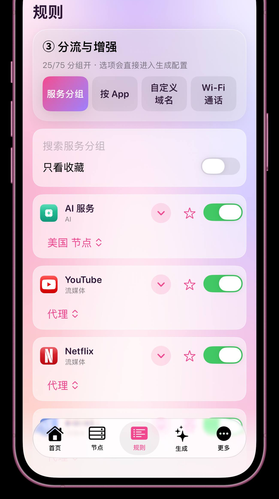

# Lowex

> 本机生成的代理配置工具 · iOS 原生 SwiftUI · 支持 Windows / iOS / Android 三个目标平台
>
> A fully on-device proxy-config generator for Windows / iOS / Android clients, built with SwiftUI.

**⚠️ 使用前请阅读 [DISCLAIMER.md](DISCLAIMER.md)。** Lowex 不提供任何节点或订阅，也不鼓励任何违反当地法律的行为。

## 功能 / Features
- **三平台**：先选 Windows / iOS / Android，再选客户端；输出只含该平台有效的规则（Windows 仅 `.exe` 进程名，Android 仅包名，iOS 无进程 / 包名）。
- **14 个客户端**：Clash Verge Rev、FlClash、Clash Mi、Clash Meta for Android、Mihomo Party、Mihomo 内核、sing-box、Karing、Surge、Quantumult X、Shadowrocket、Loon、Stash、Egern。详见 [docs/CLIENTS.md](docs/CLIENTS.md)。
- **75 个服务分组**：AI、流媒体、社交、开发、银行（汇丰、香港虚拟银行、新加坡银行）、跨境账户、远程工作、券商、数字游民工具、加密货币等；默认可选关闭。
- **故障转移**：每个地区「手动 / 自动测速 / 故转」。
- **防泄漏**：fake-ip DNS、嗅探、QUIC / STUN 拦截、广告 / 追踪 / 遥测拦截（可选）。
- **手动节点**：SOCKS5 / HTTP / HTTPS（住宅 / 家宽代理），密码存钥匙串，按客户端语法输出，详见 [docs/MANUAL-NODES.md](docs/MANUAL-NODES.md)。
- **输入体验**：节点页订阅 URL、节点链接 / Base64、手动节点三块分开；键盘「完成」按钮、点空白收起、滚动收起；全局触感反馈（可在外观里关闭）。
- **一键预设**：数字游民、加密货币、通用防泄漏等。
- **导出**：复制、系统分享、保存到「文件」、二维码；多数客户端支持 URL scheme 导入（见 [docs/IMPORT-SCHEMES.md](docs/IMPORT-SCHEMES.md)）。
- **外观**：浅色 / 深色 / 跟随系统、强调色、圆角、玻璃强度、渐变速度、字体、自定义壁纸；启动动画和生成成功烟花（遵守「减弱动态效果」）。
- **隐私**：全部在本机运行，无服务器、无统计。

## 截图 / Screenshots
| 首页 Home | 规则 Rules |
|---|---|
|  |  |

> 截图来自早期构建；当时配置名称未跟随客户端自动变化，v1.0.0 已修复。

## 安装 / Install
从 [Releases](../../releases) 下载最新版 `Lowex-native.ipa`；安装后请核对首页顶部小字的版本与 build 是否与 Release 一致（**未签名**）。
- **TrollStore**：用 TrollStore 打开 / 分享 IPA 安装（需要受支持的 iOS 版本）。
- **自行签名**：用你自己的证书 / 侧载工具（AltStore、Sideloadly 等）签名后安装。
- 系统要求：iOS 18+。作者在 iPhone XS（iOS 18.3.1 + TrollStore）上测试。

## 使用 / Usage
1. **首页**：选系统与客户端，选网络环境，按需套用预设。
2. **节点**：粘贴你自己的节点 / 订阅（Shadowrocket 的节点在 App 内添加，配置里不含节点）。
3. **规则**：开关服务分组，设定出口，可按 App / 域名 / Wi-Fi 通话分流。
4. **生成**：生成并导出；若有自己的 https 托管地址，可使用一键导入。

## 从源码构建 / Build
```
cd engine && npm install && npm run build      # 生成 native/Resources/engine.js
cd ../native && brew install xcodegen && xcodegen generate
xcodebuild -project LowexNative.xcodeproj -scheme LowexNative -configuration Release \
  -sdk iphoneos -destination 'generic/platform=iOS' CODE_SIGNING_ALLOWED=NO
```
或直接运行 GitHub Actions 的 *Build Lowex IPA*（macOS runner，输出未签名 IPA）。

## 版本 / Versioning
版本号与 GitHub tag 一致：当前 **v1.3.0**（App 首页显示 `v1.3 (build 12)`）。旧的内部 3.6 版本线记为 v1.0.x，见 [CHANGELOG.md](CHANGELOG.md)。

## FAQ
- **为什么没有节点 / 订阅？** 本工具不提供任何节点，只整理你自己的。
- **一键导入为什么要填链接？** URL scheme 无法携带本地整份文件，需要一个 https 直链；否则请用分享或「保存到文件」。
- **Shadowrocket 的订阅为什么不在配置里？** 它的节点与订阅保存在 App 首页，配置文件只含规则与策略组。
- **Quantumult X 能一键导入吗？** 官方 scheme 仅支持资源片段，请复制 / 分享后手动导入。
- **iOS 能按 App 分流吗？** 不能（没有进程 / 包名规则），Lowex 会改用服务组或域名。

## 致谢与数据来源 / Credits
Lowex 只在生成的配置里**引用**以下公开资源的 URL，不在本仓库内分发其内容；请遵循各自的许可：
- [MetaCubeX/meta-rules-dat](https://github.com/MetaCubeX/meta-rules-dat)（GPL-3.0）
- [blackmatrix7/ios_rule_script](https://github.com/blackmatrix7/ios_rule_script)（GPL-2.0）
- [SagerNet/sing-geosite / sing-geoip](https://github.com/SagerNet)
- [ACL4SSR/ACL4SSR](https://github.com/ACL4SSR/ACL4SSR)（CC BY-SA 4.0）
- 图标：Koolson/Qure、lige47/QuanX-icon-rule、luestr/IconResource、Semporia/Hand-Painted-icon、Orz-3/mini（这些仓库未声明明确许可证，仅在运行时按 URL 下载，图标版权归原作者）
- 各客户端与服务的名称、商标归其所有者。

## 许可 / License
[MIT](LICENSE)（仅适用于本仓库自有代码；第三方资源见上）。联系：wenx@xewol.com
