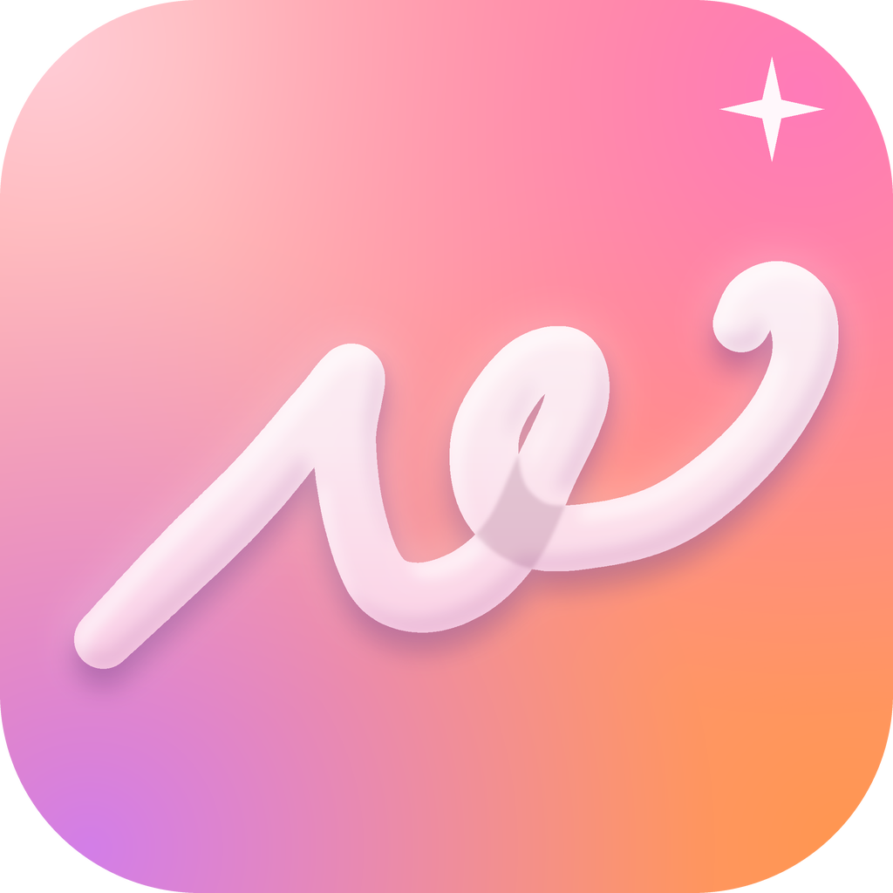

<p align="center">
  
</p>

<h1 align="center">Lowex</h1>

<p align="center">
  本機生成的代理 / 分流配置工具 · SwiftUI + TypeScript · 不聯網、不上傳
  <br>
  <sub>On-device proxy &amp; routing config generator for iPhone and iPad</sub>
</p>

<p align="center">
  <a href="https://github.com/Kiwareu/Lowex/releases/latest"></a>
  
  <a href="LICENSE"></a>
</p>

<p align="center">
  <a href="README.md">簡體中文</a> · <b>繁體中文</b> · <a href="README.en.md">English</a>
</p>

> **使用前請閱讀 [DISCLAIMER.md](DISCLAIMER.md)。** Lowex 不提供任何節點、訂閱或網路接入服務，也不鼓勵任何違反當地法律的行為。

## 簡介

Lowex 是一款執行在 iPhone / iPad 上的配置生成器：選好目標客戶端和選項，貼上你自己的節點或訂閱，一鍵匯出適合該客戶端的配置檔案（規則、策略組、DNS、防洩漏等）。所有生成都在本機完成，沒有伺服器，不上傳節點或訂閱。

## 功能

- **14 個客戶端**：Clash Verge Rev、FlClash、Clash Mi、Clash Meta for Android、Mihomo Party、Mihomo 核心、sing-box、Karing、Surge、Quantumult X、Shadowrocket、Loon、Stash、Egern。
- **按平臺輸出**：先選 Windows / iOS / Android，再選客戶端；輸出只含該平臺有效的規則（Windows 僅 `.exe` 程序名，Android 僅包名，iOS 無程序 / 包名規則）。
- **75 個服務分組**：AI、流媒體、社交、開發、銀行與券商、跨境賬戶、遠端工作、數字遊民工具、加密貨幣等，可逐組開關與指定出口。
- **故障轉移**：每個地區可選「手動 / 自動測速 / 故障轉移」，並按各客戶端文件只生成它真正支援的策略組型別。
- **防洩漏**：fake-ip DNS、嗅探、QUIC / STUN 攔截，可選的廣告 / 追蹤 / 遙測攔截。
- **網路環境**：按運營商、網路型別、所在地給出帶依據的 DNS / DoH、Bootstrap DNS、IPv6、MTU、QUIC 推薦（依據見 [docs/NETWORK-ENV.md](docs/NETWORK-ENV.md)）。
- **手動節點**：SOCKS5 / HTTP / HTTPS（住宅 / 家寬代理），密碼存系統鑰匙串，按客戶端語法輸出（見 [docs/MANUAL-NODES.md](docs/MANUAL-NODES.md)）。
- **一鍵預設、備份與恢復**：數字遊民、加密貨幣、通用防洩漏等預設；設定可匯出為 JSON 並恢復。
- **匯出**：複製、系統分享、儲存到「檔案」、二維碼；多數客戶端支援 URL scheme 匯入（見 [docs/IMPORT-SCHEMES.md](docs/IMPORT-SCHEMES.md)）。
- **介面**：手寫簽名風格的字標、淺色 / 深色、強調色、圓角、玻璃強度、漸變速度、字型、自定義桌布、觸感反饋；尊重「減弱動態效果」。
- **多語言**：簡體中文 / 繁體中文（臺灣、香港）/ English，預設跟隨系統，可在 App 內切換（見 [docs/LOCALIZATION.md](docs/LOCALIZATION.md)）。

## 截圖

| 首頁 | 規則 |
|---|---|
|  |  |

> 截圖來自較早的構建，介面細節以實際版本為準。

## 支援的客戶端

| 客戶端 | 平臺 | 匯出格式 | 節點 / 訂閱 |
|---|---|---|---|
| Clash Verge Rev / Mihomo Party | Windows · macOS · Linux | `.yaml` | 寫入配置，或在 App 內新增 |
| FlClash | Windows · macOS · Linux · Android | `.yaml` | 寫入配置，或在 App 內新增 |
| Clash Mi | iOS · Android · Windows · macOS | `.yaml` | 寫入配置，或在 App 內新增 |
| Clash Meta for Android | Android | `.yaml` | 寫入配置，或在 App 內新增 |
| Mihomo 核心 | Linux · Windows · macOS · Android | `.yaml` | 寫入配置 |
| sing-box | Windows · macOS · Linux · Android · iOS | `.json` | 寫入配置 |
| Karing | iOS · Android · Windows · macOS | `.json` | 寫入配置 |
| Surge | iOS · macOS | `.conf` | 寫入配置 |
| Quantumult X | iOS | `.conf` | 寫入配置，或在 App 內新增 |
| Shadowrocket | iOS · macOS | `.conf` | 寫入配置，或在 App 內新增 |
| Loon | iOS | `.conf` | 寫入配置 |
| Stash | iOS · macOS | `.yaml` | 寫入配置 |
| Egern | iOS · macOS | `.yaml` | 寫入配置 |

逐客戶端的調研、置信度與一手來源見 [docs/CLIENTS.md](docs/CLIENTS.md)。

## 平臺與系統要求

- **執行 Lowex 的裝置**：iPhone / iPad，**iOS 15.0 及以上**（與 sing-box、Karing 等客戶端的最低要求相當；依據見 [docs/COMPATIBILITY.md](docs/COMPATIBILITY.md)）。
- **生成的配置面向**：Windows / macOS / Linux / Android / iOS 上的各客戶端。
- 作者日常在 iOS 18 裝置上測試；iOS 15–17 目前只做過編譯驗證，沒有逐版本的真機測試，遇到問題請提 Issue。

## 工作原理

- 全部在本機執行：沒有伺服器，不上傳節點、訂閱或生成結果；唯一的網路請求是可選的 App Store 搜尋（iTunes Search API）和規則圖示（已內建，另可從公開圖示庫補充）。
- 介面用 **SwiftUI** 編寫；生成引擎是 **TypeScript**，打包成 `engine.js` 後在系統自帶的 **JavaScriptCore** 裡執行。
- 引擎按所選客戶端的能力矩陣裁剪選項，生成後用各客戶端的官方校驗工具（mihomo `-t`、`sing-box check`）做迴歸測試。

## 安裝

> Lowex 不在 App Store 上架，提供**未簽名 IPA**。

1. 到 [Releases](https://github.com/Kiwareu/Lowex/releases) 下載最新的 `Lowex-vX.Y.Z.ipa`（旁邊的 `.sha256` 檔案可校驗完整性）。
2. 安裝方式任選：
   - **TrollStore**：在受支援的系統上（官方支援 iOS 14.0–16.6.1、16.7 RC、17.0）用 TrollStore 開啟 IPA 安裝。
   - **自行簽名 / 側載**：用 AltStore、Sideloadly、Feather 等工具，以你自己的 Apple ID 或證書籤名後安裝。
3. 校驗：`shasum -a 256 -c Lowex-vX.Y.Z.ipa.sha256`。

## 使用

1. **首頁**：選系統與客戶端，選網路環境，按需套用預設。
2. **節點**：貼上你自己的節點 / 訂閱；對支援的客戶端，可選擇「寫入配置」或「客戶端內新增」。
3. **規則**：開關服務分組、設定出口，可按 App / 域名 / Wi-Fi 通話分流。
4. **生成**：生成後複製、分享、儲存到檔案、掃碼，或用 URL scheme 一鍵匯入。

## 從原始碼構建

需要 macOS、Xcode 與 Node.js。

```bash
cd engine && npm install && npm run build       # 生成 native/Resources/engine.js
cd ../native && brew install xcodegen && xcodegen generate
xcodebuild -project LowexNative.xcodeproj -scheme LowexNative -configuration Release \
  -sdk iphoneos -destination 'generic/platform=iOS' CODE_SIGNING_ALLOWED=NO
```

也可以直接執行 GitHub Actions 的 *Build Lowex IPA*（macOS runner，輸出未簽名 IPA）。

## 驗證與測試

- 引擎的輸出用 `mihomo -t` 與 `sing-box check` 校驗，並對隨機選項組合做模糊測試（IPv6 / TUN / fake-ip / 故障轉移 / 廣告攔截 / STUN / QUIC 等）。
- `python3 tools/check-i18n.py` 檢查 4 張介面語言表是否齊全。
- 編譯由 CI（macOS runner）驗證；沒有自動化的介面測試。

## 貢獻

歡迎 Issue 與 PR，詳見 [CONTRIBUTING.md](CONTRIBUTING.md) 與 [行為準則](CODE_OF_CONDUCT.md)。請不要在 Issue 裡貼節點、訂閱連結或令牌。

## 安全

漏洞請透過 GitHub 的 *Security → Report a vulnerability*（私密安全公告）提交，詳見 [SECURITY.md](SECURITY.md)。

## 許可

[MIT](LICENSE)（僅適用於本倉庫自有程式碼）。內建字型 Great Vibes 使用 SIL OFL 1.1，許可證見 [docs/brand/OFL-GreatVibes.txt](docs/brand/OFL-GreatVibes.txt)。第三方規則與圖示來源見下。

## 免責宣告

Lowex 與文中提到的任何客戶端、服務、銀行或平臺均無隸屬、授權或背書關係，相關名稱與商標歸其各自權利人所有。請遵守所在地法律法規，詳見 [DISCLAIMER.md](DISCLAIMER.md)。

## 更新日誌

見 [CHANGELOG.md](CHANGELOG.md) 與 [Releases](https://github.com/Kiwareu/Lowex/releases)。

## 致謝與資料來源

Lowex 只在生成的配置裡**引用**以下公開資源的 URL，不在本倉庫內分發其內容，請遵循各自的許可：

- [MetaCubeX/meta-rules-dat](https://github.com/MetaCubeX/meta-rules-dat)（GPL-3.0）
- [blackmatrix7/ios_rule_script](https://github.com/blackmatrix7/ios_rule_script)（GPL-2.0）
- [SagerNet/sing-geosite / sing-geoip](https://github.com/SagerNet)
- [ACL4SSR/ACL4SSR](https://github.com/ACL4SSR/ACL4SSR)（CC BY-SA 4.0）
- 圖示重繪參考了 Koolson/Qure、lige47/QuanX-icon-rule、luestr/IconResource、Semporia/Hand-Painted-icon、Orz-3/mini 等社群圖示庫；品牌標誌歸各權利人所有，僅用於識別對應服務。內建圖示另見 [Lowex-Icons](https://github.com/Kiwareu/Lowex-Icons)。
- 字型：[Great Vibes](https://github.com/googlefonts/great-vibes)（SIL OFL 1.1）。
